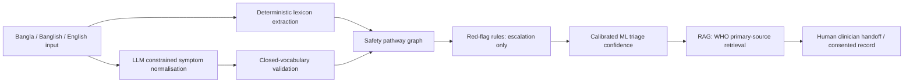

# AI-native safety architecture

SasthoSetu intentionally uses several AI techniques, but none may bypass the
deterministic emergency-safety layer.

- **LLM:** only maps free text to the existing symptom vocabulary. PII is
  redacted, provider hosts are allowlisted, and failures fall back to rules.
- **Graph:** the care pathway is a directed safety graph: input -> extraction
  -> red flags -> triage -> evidence -> clinician handoff. A later layer may
  never lower an emergency escalation made by an earlier safety node.
- **ML:** the trained triage classifier and research image models provide
  bounded support, confidence bands and low-confidence review prompts.
- **RAG:** retrieval returns curated WHO source cards relevant to red flags or
  dengue/arboviral symptoms. It does not generate prescriptions or diagnoses.

Every production claim must preserve this distinction: AI assists navigation
and screening; it does not autonomously diagnose or replace a clinician.
